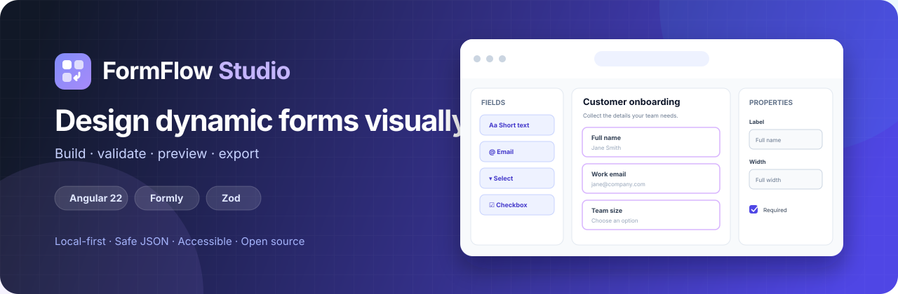
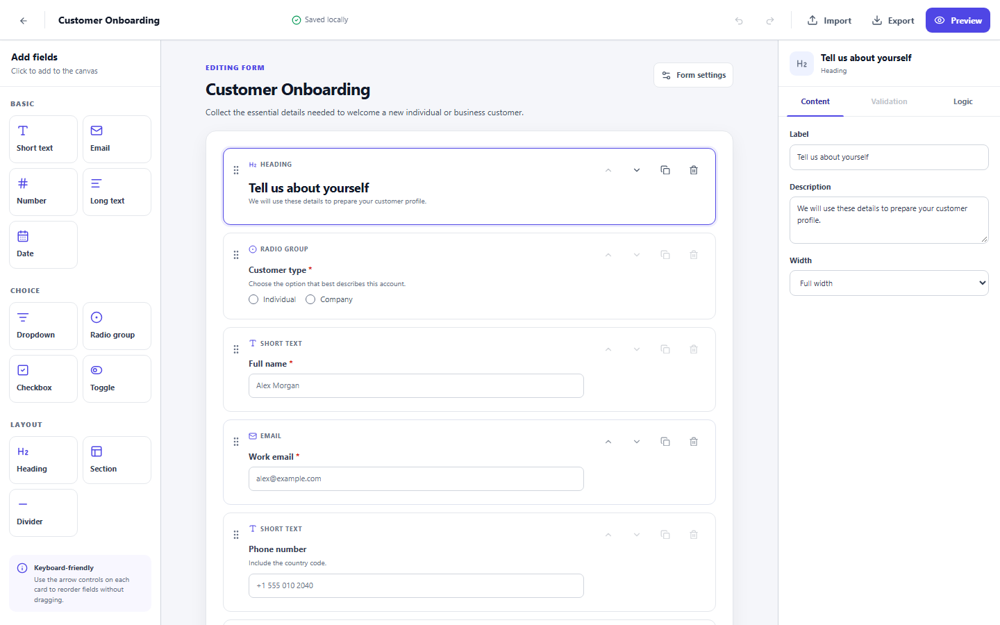

# FormFlow Studio

> Build, validate, preview, and exchange dynamic Angular forms without writing the
> configuration by hand.

[](https://github.com/BuinvschiiSlava/formflow-studio/actions/workflows/ci.yml)
[](https://github.com/BuinvschiiSlava/formflow-studio/actions/workflows/e2e.yml)
[](https://github.com/BuinvschiiSlava/formflow-studio/actions/workflows/deploy.yml)
[](LICENSE)

**[Live demo](https://buinvschiislava.github.io/formflow-studio/)** ·
**[Русская версия](README.ru.md)**

FormFlow Studio is a local-first visual editor for schema-driven forms. It combines a
field palette, an ordered builder canvas, a focused property inspector, and a live Formly
preview. Documents can be exported as versioned JSON and imported later with runtime
validation and actionable error messages.

## Why this project exists

Dynamic forms are powerful, but large handwritten configurations are difficult to review,
reuse, and maintain. FormFlow Studio turns that configuration into an explicit document
model and makes common form-building work visual while keeping the exported result
portable and deterministic.

## Features

- Visual form builder with add, select, duplicate, delete, and reorder operations.
- Input fields: text, email, number, textarea, date, select, radio, checkbox, and toggle.
- Layout elements: heading, divider, and section.
- Editable labels, keys, descriptions, placeholders, defaults, widths, and options.
- Validation rules for required values, lengths, numeric bounds, and patterns.
- Declarative `show` and `enable` conditions that reference another field.
- Live Angular Formly preview with validation feedback.
- English and Russian document locales.
- Versioned JSON import and export with strict runtime validation.
- Fifty-step undo/redo history and automatic local drafts.
- Four practical starter templates for common business workflows.
- Deterministic TypeScript interface generation for submitted values.
- Local persistence; form data is not sent to a backend.
- Keyboard-accessible controls and responsive layouts.
- Hash-based routing for reliable static hosting on GitHub Pages.

## Builder workspace



## Technology

- Angular 22.2.3 and TypeScript 6
- Angular Material/CDK 22.2.3
- Formly 10.0.1
- RxJS 7.8
- Zod 4 for boundary validation
- Vitest and Angular Testing Utilities
- Playwright and axe-core for browser and accessibility checks

## Getting started

### Prerequisites

- Node.js 24 (the exact major is recorded in [`.nvmrc`](.nvmrc))
- npm 11; the repository records npm 11.17.0 in `package.json`

With a Node version manager:

```bash
nvm use
npm ci
npm start
```

Open <http://localhost:4200/>. The development server reloads when source files change.

### Useful commands

```bash
# Development server
npm start

# Production build
npm run build

# Unit tests
npm test

# Unit tests with coverage
npm run test:coverage

# ESLint
npm run lint

# Formatting check
npm run format:check

# Install Playwright's browser once, then run E2E tests
npx playwright install chromium
npm run e2e
```

## Using the editor

1. Name the form and choose its locale.
2. Add controls and layout elements from the field palette.
3. Select an item on the canvas and configure it in the inspector.
4. Add validation or a condition when the field requires it.
5. Exercise the live preview, including invalid and conditional states.
6. Export the document to JSON or import a previously exported document.

The importer validates the complete document before creating a separate local draft. It
never overwrites the form currently being edited. An invalid file produces a precise path
and message and is never partially applied.

## JSON document format

Documents use an application-owned format rather than raw executable Formly
configuration. The current schema version is `1`.

```json
{
  "schemaVersion": 1,
  "id": "form_550e8400-e29b-41d4-a716-446655440000",
  "title": "Customer request",
  "description": "Collect the details required by support.",
  "locale": "en",
  "submitLabel": "Send request",
  "fields": [
    {
      "id": "field_550e8400-e29b-41d4-a716-446655440001",
      "key": "emailAddress",
      "type": "email",
      "label": "Email address",
      "description": "We will use this address for status updates.",
      "placeholder": "name@example.com",
      "width": "full",
      "options": [],
      "validation": {
        "required": true
      }
    }
  ],
  "createdAt": "2026-10-19T12:00:00.000Z",
  "updatedAt": "2026-10-19T12:00:00.000Z"
}
```

See [JSON schema and import contract](docs/JSON_SCHEMA.md) for every field, limit, and
compatibility rule.

### Import security

Imported files are treated only as data. FormFlow Studio does not accept functions, Formly
expression strings, or other executable values; HTML-like strings are rendered as plain
text. Unknown properties and unsupported schema versions are rejected. Never add `eval`,
`new Function`, or direct execution of imported expressions to the import pipeline.

## Architecture

The application keeps its portable domain document independent from Formly. Store
operations update immutable document state; a dedicated adapter derives preview-only
Formly configuration. Serialization and validation live at the system boundary.

See [Architecture](docs/ARCHITECTURE.md) for responsibilities, data flow, and the security
model.

## Quality

Every pull request runs formatting, linting, unit tests, a production build, browser tests,
and automated accessibility checks. The important manual checks are keyboard-only
operation, focus behavior, responsive reflow, and a screen-reader pass.

- [Testing guide](docs/TESTING.md)
- [Deployment guide](docs/DEPLOYMENT.md)
- [Security policy](SECURITY.md)

## Browser support

The latest stable versions of Chrome, Edge, Firefox, and Safari are supported. The editor
requires modern browser APIs including `crypto.randomUUID` and `structuredClone`.

## Data and privacy

Form documents remain in the browser and are only written to files when the user explicitly
exports them. The hosted application has no account system and no server-side persistence.
Avoid entering real secrets or sensitive production data into any public demo.

## Roadmap

- Multi-step forms and reusable groups.
- User-created and shareable template packs.
- Version comparison and migration previews.
- Optional code export for Angular/Formly projects.

Roadmap items are not guaranteed until they are included in a release.

## Contributing

Issues and focused pull requests are welcome. Read [CONTRIBUTING.md](CONTRIBUTING.md), the
[Code of Conduct](CODE_OF_CONDUCT.md), and [SECURITY.md](SECURITY.md) before contributing.

## License

Released under the [MIT License](LICENSE).

## Author

Created by [BuinvschiiSlava](https://github.com/BuinvschiiSlava). For professional contact,
use Telegram: [@sudo_runn](https://t.me/sudo_runn).
